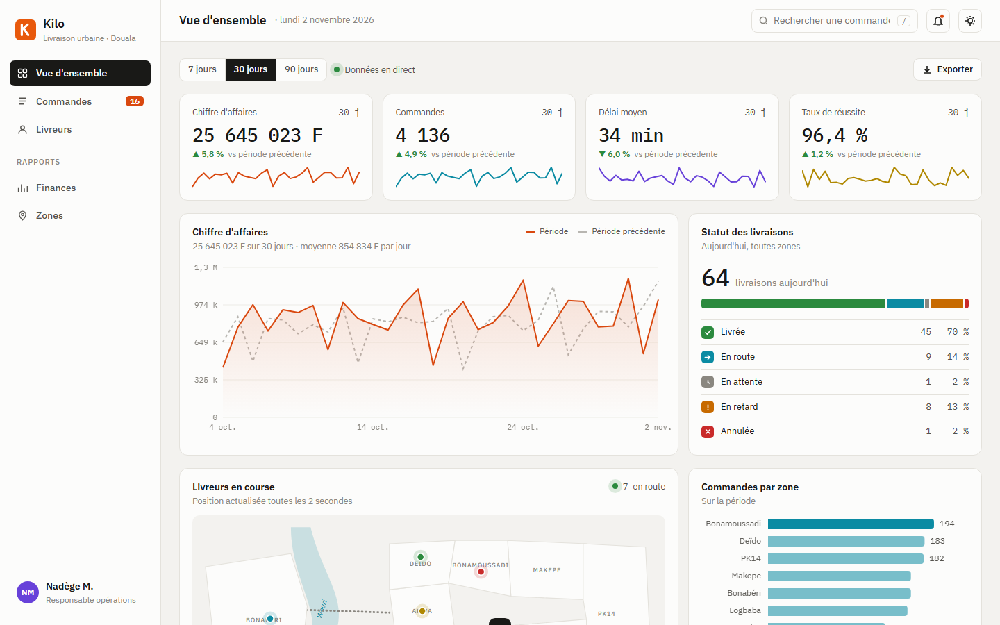
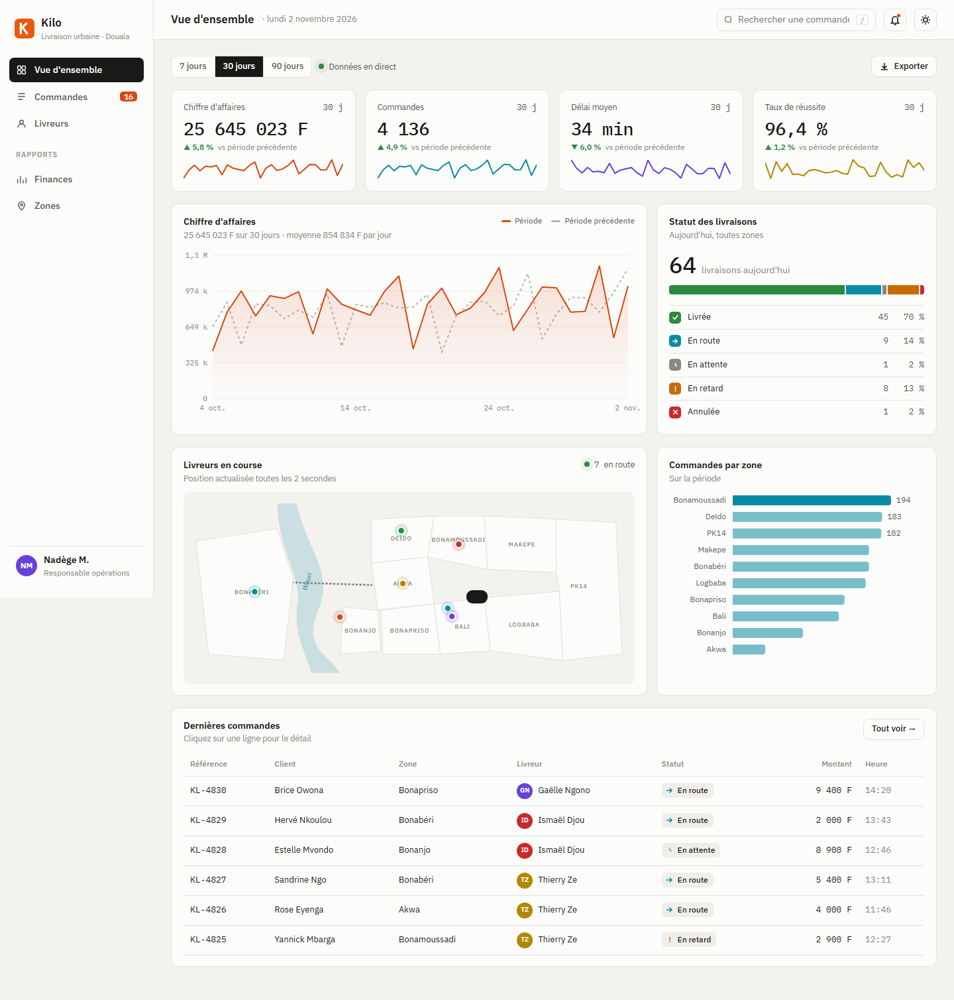
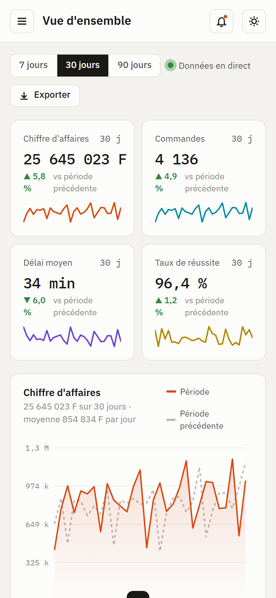

# Kilo

**Dashboard · Back-office** — Back-office d'un service de livraison urbaine à Douala : indicateurs clés, graphiques interactifs, carte des livreurs en direct, gestion des commandes et mode sombre.

**Démo en ligne : [https://lordlennyx.github.io/kilo-dashboard/](https://lordlennyx.github.io/kilo-dashboard/)**

Spot de présentation (30 s) : [media/spot-30s.mp4](https://lordlennyx.github.io/kilo-dashboard/media/spot-30s.mp4)

## Ce que le projet montre

- Graphiques SVG faits main : courbe avec réticule et infobulle, barres par zone, répartition des statuts
- Palette vérifiée pour le daltonisme et le contraste, en clair comme en sombre ; statuts toujours doublés d'une icône
- Carte stylisée de Douala avec livreurs animés en temps réel
- Table des commandes : recherche, filtres, tri par colonne, pagination, export CSV compatible Excel
- Fiche commande avec chronologie, application monopage à routes (#commandes, #livreurs), raccourci clavier /

## Réalisation

- **Stack :** HTML, CSS, JavaScript natif, SVG
- **Typographies :** IBM Plex Sans, IBM Plex Mono
- **Prêt pour :** brancher une API REST (Node, Laravel, Supabase)

| Bureau | Mobile |
|---|---|
|  |  |

---

Client et contenus fictifs, créés pour la démonstration. Conception, design et développement : **Njundiyimun Béchard** — [github.com/LordLennyx](https://github.com/LordLennyx)
